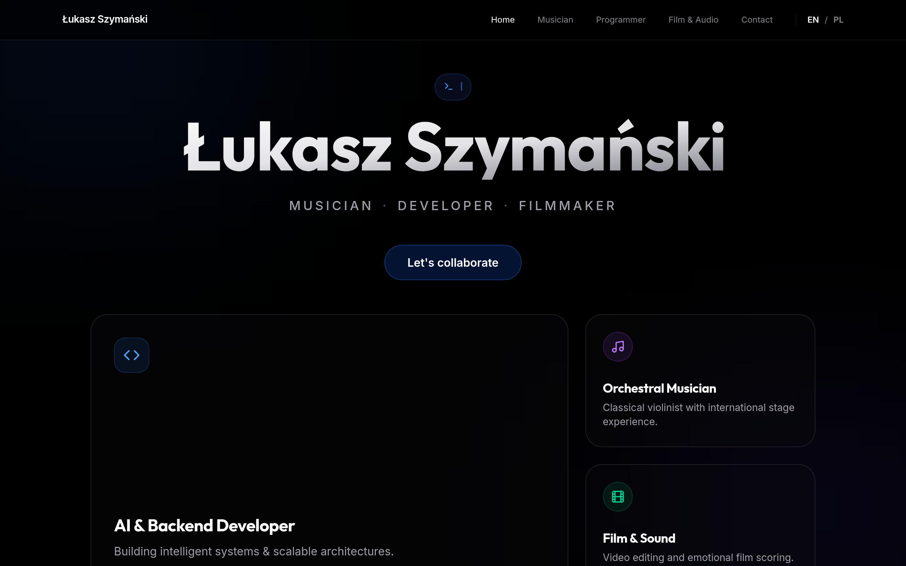

# szymanski.studio

Source code for [szymanski.studio](https://szymanski.studio) - my personal website and freelance portfolio covering software engineering, classical music, and video production.



## Stack

- **Framework:** [Astro](https://astro.build/) (Static Site Generation)
- **Styling:** [Tailwind CSS v4](https://tailwindcss.com/)
- **Language:** TypeScript
- **Icons:** [Lucide Astro](https://lucide.dev/)
- **Deployment:** Netlify

## Features

- **Bilingual Routing (EN / PL):** Localized routes (`/` and `/pl/`) backed by typed translation dictionaries in `src/i18n/ui.ts`, with automatic browser locale detection and `localStorage` persistence.
- **Static Performance:** Zero client-side JavaScript by default, pre-rendered routes, and optimized video/image assets.
- **Technical SEO:** Automated `sitemap.xml` generation, canonical URLs, OpenGraph metadata, and JSON-LD structured data.

## Project Structure

```text
portfolio/
├── src/
│   ├── assets/       # Optimized images and media
│   ├── i18n/         # Translation dictionaries and locale helpers
│   ├── layouts/      # Base HTML layout and SEO head metadata
│   ├── pages/        # Route views (English at root, Polish under /pl/)
│   └── styles/       # Global styles and Tailwind configuration
├── public/           # Static assets (videos, favicons, OpenGraph images)
├── astro.config.mjs  # Astro & sitemap configuration
└── package.json
```

## Local Development

Requires **Node.js >= 22.12.0**.

```bash
# Install dependencies
npm install

# Start local dev server at http://localhost:4321
npm run dev

# Build static production output to ./dist/
npm run build

# Preview production build locally
npm run preview
```

## License

Released under the [MIT License](LICENSE).
